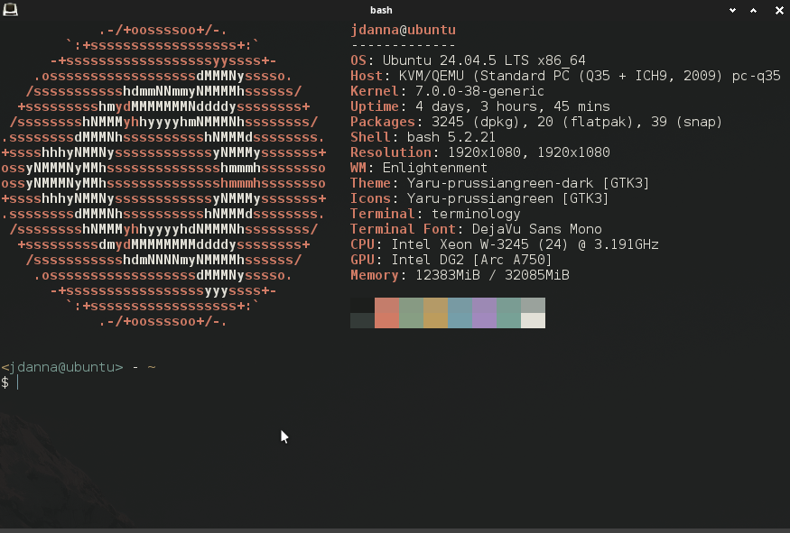

= quiet for Terminology

quiet-day and quiet-night color schemes for
https://www.enlightenment.org/about-terminology[Terminology], ported from
https://github.com/chrismecca/quiet[quiet] 0.5.0.

----
make install
terminology -C quiet-night
----

`make install` copies the schemes to `~/.config/terminology/colorschemes/`.
You can also pick one under _Settings → Colors_.

The schemes were named `Quiet Day` and `Quiet Night` before quiet 0.5.0.
`make uninstall` removes both names.

Faint text uses Muted, and faint colors are the normal colors composited
over Field at the opacity of quiet's Subtle role, as in quiet's own
terminal ports.

Everything in `colorschemes/` is generated by `tools/quiet_terminology.py`.
To regenerate the schemes, run `make build`. To verify them, run
`make check`. To follow a new quiet release, run `make vendor` with a
quiet checkout at `../quiet` (or `QUIET=path`), then `make build`.
